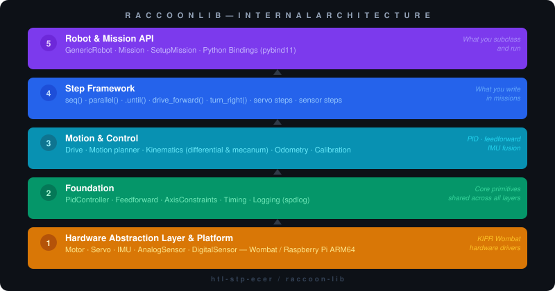

<div align="center">


# raccoon-lib

**The core robotics library powering RaccoonOS for Botball.**

PID motion control · Kinematics · Odometry · Step-based missions · Python bindings

[](LICENSE)


[](https://github.com/htl-stp-ecer/raccoon-lib/actions/workflows/ci.yml)
[](https://github.com/htl-stp-ecer/raccoon-lib/releases/latest)

> 📖 **Full documentation at [raccoon-docs.pages.dev](https://raccoon-docs.pages.dev/)**

</div>

---

raccoon-lib is the heart of [RaccoonOS](https://github.com/htl-stp-ecer) — a full robotics platform built for [Botball](https://www.kipr.org/botball/) competition. It gives your robot a solid foundation: reliable motion, clean sensor abstractions, and a step-based mission system that makes autonomous code readable and maintainable.

Built from years of competition experience at HTL St. Pölten, it's designed so that new teams don't have to start from zero.

---

## What's Inside

| Module | What it does |
|:-------|:-------------|
| **Motion Control** | PID-controlled `drive_forward`, `turn_right`, `strafe_left` with feedforward compensation |
| **Calibration** | Auto-tune feedforward (kS, kV, kA) and PID via relay-feedback — no guessing |
| **Kinematics** | Differential and mecanum drivetrains — forward & inverse |
| **Odometry** | Real-time position and heading from wheel encoders + IMU fusion |
| **Step Framework** | `seq()`, `parallel()`, `.until()` — write missions like a readable recipe |
| **Sensors & Actuators** | IR sensors, buttons, servos — clean, consistent API |
| **Python Bindings** | Full Python API via pybind11 — same power, less boilerplate |

---

## Getting Started

> raccoon-lib runs on the [KIPR Wombat](https://www.kipr.org/kipr/hardware-software) controller (Raspberry Pi, ARM64). Local installs without a mock platform are not supported — deploy directly to the Pi.

**1. Clone**

```bash
git clone https://github.com/htl-stp-ecer/raccoon-lib.git --recurse-submodules
cd raccoon-lib
```

**2. Build & deploy to your Pi**

```bash
python3 build.py                      # cross compiles for ARM64 in Docker -> builds/
python3 deploy.py --host <your-pi-ip> # installs the wheels on your Pi over SSH
```

No local toolchain setup needed, only Docker. `build.py` writes `builds/raccoon_sim-0.0-…-linux_aarch64.whl` (compiled runtime + simulator) and `builds/raccoon_library-0.0-py3-none-any.whl` (type stubs) with the same version. `--version N` sets the version (CI does this), `--test` also runs the C++ tests with qemu-user. `deploy.py` is for local builds and marks `raccoon-lib` as `dev` in the Pi's bundle file; releases are installed by `raccoon update`.

> **Starting a new robot project?** Run the setup script of [`raccoon-template`](https://github.com/htl-stp-ecer/raccoon-template), see [Getting Started](https://raccoon-docs.pages.dev/00-getting-started/03-create-your-project/). [`raccoon-cli`](https://github.com/htl-stp-ecer/raccoon-cli)'s `raccoon codegen` then generates the hardware code from your project config.

### Installing from PyPI

raccoon-lib ships as two coordinated distributions:

| Command | What you get | Use it for |
|:--------|:-------------|:-----------|
| `pip install raccoon-library` | Platform-independent Python/`.pyi` **headers** (`py3-none-any`). No compilation, no native code. | IDE type hints, type-checking, and the `raccoon-cli` toolchain codegen. Does **not** run the robot on its own. |
| `pip install "raccoon-library[sim]"` | The above **plus** the compiled `raccoon-sim` bindings + simulator + mock/wombat runtime bundle. | Actually running missions in the simulator, or on the Pi/Wombat. |

The `[sim]` extra pulls in `raccoon-sim`, pinned to the exact same version, so the
headers and the native bindings can never drift apart. `import raccoon` requires
`[sim]` (or a locally deployed `raccoon-sim` wheel — see `deploy.py` above).

---

## How It Works

You write missions. raccoon-lib handles the math.

Missions are Python classes with a `sequence()` method — describe what the robot does step by step:

```python
from raccoon import *

class M01NavigateToZone(Mission):
    def sequence(self) -> Sequential:
        return seq([
            mark_heading_reference(),       # lock current heading as 0°

            parallel(
                drive_forward(cm=40),       # drive while lowering arm
                seq([
                    wait_until_distance(7),
                    servo(Defs.arm_servo, 90),
                ]),
            ),

            turn_right(degrees=90),

            # drive until both IR sensors see black tape
            drive_forward().until(
                on_black(Defs.front.left) & on_black(Defs.front.right)
            ),

            drive_backward(cm=3),
        ])
```

The robot hardware config (motors, sensors, PID gains) lives in the project's `raccoon.project.yml`, and `raccoon-cli` generates `Defs` and the robot class from it.

---

## Architecture

<div align="center">
  
</div>

---

## Requirements

- CMake >= 3.15
- C++20 compatible compiler
- Python >= 3.11
- Docker (for ARM64 cross-compilation)

**C++ dependencies:** Eigen3 3.4.0 · spdlog 1.14.1 · pybind11 2.13.6 · [raccoon-transport](https://github.com/htl-stp-ecer/raccoon-transport)
**Python dependencies:** pyyaml · aiosqlite · numpy · raccoon-transport

---

## Testing

```bash
# C++ tests
cmake -B build -DBUILD_TESTING=ON
cmake --build build
ctest --test-dir build

# Python tests
pytest tests/
```

---

## Contributing

See [CONTRIBUTING.md](CONTRIBUTING.md) for how to add modules, steps, run tests, and follow code style.

---

## License

Copyright (C) 2026 Tobias Madlberger
Licensed under the GNU General Public License v3.0 — see [LICENSE](LICENSE) for details.
